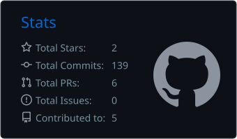
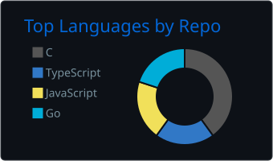
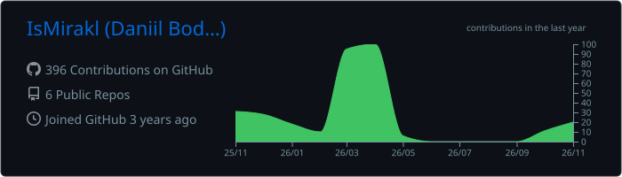

# Привет, я Даня 👋

### Backend-разработчик · C# / .NET

19 лет. Пишу бэкенд, развиваю свои проекты и изучаю экосистему .NET.

[Telegram](https://t.me/NoCyberAttack) · [Email](mailto:mirakldanya@gmail.com) · [Проекты](https://github.com/IsMirakl?tab=repositories)

---

## Обо мне

- **Сейчас мой основной язык — C#.** Развиваюсь в backend-разработке на .NET и ASP.NET Core.
- Раньше писал на **Go** — этот опыт остаётся частью моего стека.
- Для веб-интерфейсов использую **React и TypeScript**.
- Люблю превращать идеи в работающие приложения — от API до интерфейса.

## Технологии

| Направление | Стек |
| :--- | :--- |
| **Основной фокус** | C# · .NET · ASP.NET Core |
| **Backend и данные** | Go · Node.js · PostgreSQL |
| **Frontend** | React · TypeScript · JavaScript · HTML · CSS · Tailwind CSS |
| **Инструменты** | Git · Postman · VS Code · Figma |

## GitHub в цифрах

### Активность

SVG-карточки хранятся в этом репозитории и обновляются ежедневно через GitHub Actions. Языки определяются по репозиториям, а не по уровню владения.

## Проекты

### [OpsForge ↗](https://github.com/IsMirakl/OpsForge)
Рабочее пространство для мониторинга серверов и инфраструктуры: состояние ресурсов, метрики и управление доступом.

`C#` `ASP.NET Core` `React` `TypeScript`

### [TeamUp ↗](https://github.com/IsMirakl/TeamUp)
Платформа для поиска партнёров и команд для стартапов и личных проектов — по навыкам, интересам и целям.

### [PTKnow ↗](https://github.com/IsMirakl/PTK-project)
Информационный портал для Политехнического колледжа ПТИ НовГУ: дополнительные образовательные программы и полезная информация для студентов.

---

### На связи

Есть идея или хочешь обсудить проект? Напиши.

